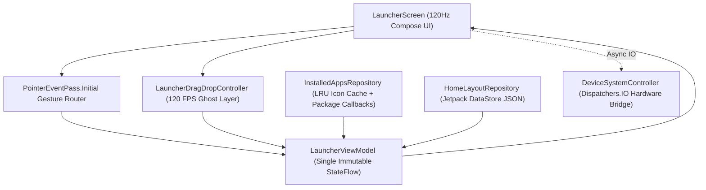

# Architecture & 120 FPS Engine / Mimari ve 120 FPS Motoru

## 🏗️ Unidirectional Data Flow (UDF)

---

## ⚡ Key Engineering Decisions / Temel Mimari Kararlar

1. **`PointerEventPass.Initial` Top Pull-Down Routing (`LauncherScreen.kt`):**
   - Downward swipes starting in the top status bar strip (`0..62dp`) or upper Home Screen (`0..44%`) are intercepted on `PointerEventPass.Initial` *before* `HorizontalPager` or icon click handlers can compete with diagonal thumb trajectories.
   - `awaitFirstDown` is strictly the first suspension point in every `awaitEachGesture` loop, guaranteeing zero CPU usage when idle or while overlays are open.

2. **GPU-Only Micro-Motions (`Modifier.graphicsLayer`):**
   - Background depth recession (`scale = 0.945f`, `alpha = 0.62f`), `HorizontalPager` interpolation, floating drag ghost translation, and phase-staggered Edit Mode jiggle all execute purely on the RenderThread via `graphicsLayer`, avoiding Compose measure/layout passes.

3. **Zero Main-Thread Binder IPC:**
   - App enumeration (`LauncherApps`), adaptive squircle icon rasterization (`LruCache`), and hardware telemetry (`BatteryManager`, `AudioManager`, `ConnectivityManager`, `Settings.System`) run off the Main UI Thread (`Dispatchers.IO` / `Dispatchers.Default`).

4. **Native High Refresh Rate (`HighRefreshRateHelper.kt`):**
   - Queries `Display.supportedModes` for the highest refresh rate matching the native resolution (`90Hz` / `120Hz` / `144Hz`) and locks `WindowManager.LayoutParams.preferredDisplayModeId`.
